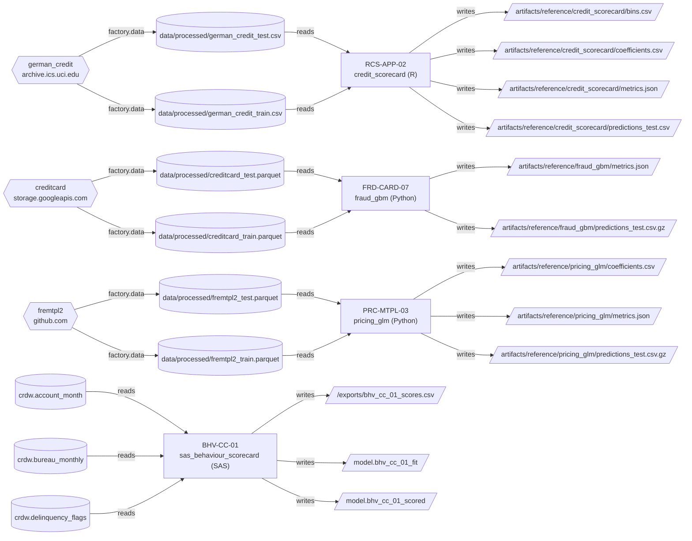

# Model inventory

Generated by Stage 2 (Discover) from the model cards. Gate status is live in the UI.

| model_id | model_ref | name | language | owner | purpose | model_type | risk_tier | last_validation_date | documentation_status | n_gaps |
|---|---|---|---|---|---|---|---|---|---|---|
| credit_scorecard | RCS-APP-02 | Retail Application Scorecard (RCS-APP-02) | R | Retail Credit Risk Modelling | Estimates 12-month probability of default for unsecured personal loan applications. | Application PD scorecard: weight-of-evidence binning with logistic regression, scaled to points | high | 2021-03-15 | outdated | 5 |
| fraud_gbm | FRD-CARD-07 | fraud_gbm | Python | unknown | Card transaction fraud detection model using gradient boosting on anonymised card transactions. | Gradient boosting classifier (sklearn HistGradientBoostingClassifier) for card fraud | unknown | unknown | missing | 4 |
| pricing_glm | PRC-MTPL-03 | Motor TPL claim frequency GLM | Python | Personal Lines Pricing | Expected claim frequency per policy-year, used as the frequency component of the technical premium. | Poisson GLM with log link and log(exposure) offset (motor TPL claim frequency) | high | 2024-11 | outdated | 4 |
| sas_behaviour_scorecard | BHV-CC-01 | Credit Card Behavioural Score (BHV-CC-01) | SAS | Cards Risk Analytics | Monthly behavioural PD for existing credit card accounts, used for limit management and collections prioritisation. | Behavioural PD scorecard (logistic regression with stepwise variable selection) | medium | unknown | missing | 3 |

## Gaps

### credit_scorecard
- Documentation contradicts code: Methodology note describes four coarse-classed characteristics with 4 bins each (checking account, duration, credit history, savings); code uses all candidate variables with 5 quantile bins for numeric variables and IV >= 0.02 selection.
- Documentation contradicts code: Methodology note states scores scaled to 500 points at odds 20:1 with 25 points to double odds; code uses base score 600 at odds 50:1 and PDO 20.
- Documentation contradicts code: Methodology note says validation was March 2021 by internal team; header says last validated 2021-03-15 (consistent), but note says model uses coarse-classed dummy bins while code uses WoE-transformed variables in logistic regression, not dummy-coded bins.
- Documentation last updated 2019-06 (89 months ago; limit 24).
- Validation overdue: last validated 2021-03-15 (68 months ago; high tier requires every 12 months).

### fraud_gbm
- Documentation missing: no documentation file is kept with the code (only code comments).
- No validation record: last independent validation date is unknown.
- No owner recorded.
- No risk tier recorded.

### pricing_glm
- Documentation contradicts code: README states exposure is capped at one year and claim counts at four, but the code applies no such caps; it uses Exposure and ClaimNb as-is (only BonusMalus is clipped, at 150).
- Documentation contradicts code: README says VehPower is a rating factor and the model uses it, but the README states no clipping; the code clips VehPower at 9, which the documentation does not mention.
- Documentation last updated 2024-09 (26 months ago; limit 24).
- Validation overdue: last validated 2024-11 (24 months ago; high tier requires every 12 months).

### sas_behaviour_scorecard
- Documentation missing: no documentation file is kept with the code (only code comments).
- No validation record: last independent validation date is unknown.
- Not executable here (no runtime for SAS): outputs cannot be reproduced; document only.

## Dependency map

