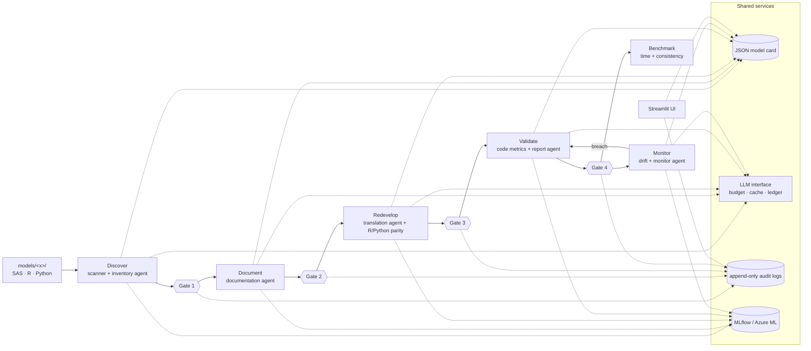

# Architecture

## Components



ASCII view:

```
                ┌──────────────────────── make run MODEL=x ────────────────────────┐
                │                         Orchestrator                              │
models/x/ ──►   │  Discover ─► Gate1 ─► Document ─► Gate2 ─► Redevelop ─► Gate3 ─►  │
 (R/Py/SAS)     │  Validate ─► Gate4            (Monitor ─► re-Validate ─► Gate4)  │
                └───────┬──────────────┬───────────────┬───────────────┬────────────┘
                        │              │               │               │
                 model card (JSON) LLM interface    gate audit log   MLflow tracking
                 artifacts/        (budget, cache,  artifacts/audit/ local file store or
                 model_cards/      ledger)          gate_decisions   Azure ML workspace
                                                    .jsonl
                        └──────────── Streamlit UI (inventory, gates, audit, spend) ───┘
```

| Component | File | Responsibility |
|---|---|---|
| Config | `src/factory/config.py`, `config/config.yaml` | One place for models per agent, prices, budgets, tracking backend and gate order. Env vars override provider/backend. |
| Model card | `src/factory/model_card.py`, `schemas/model_card.schema.json` | The shared record passed between stages. It is validated against a JSON Schema on every save, `card_version` goes up on each save, and the `history` list records why. |
| Gates | `src/factory/gates.py` | Append-only JSONL audit log of decisions (`approve`/`reject`/`comment`, reviewer, reason, timestamp, card version). It also works out the status of each gate. |
| LLM interface | `src/factory/llm.py` | The only way agents reach an LLM. It routes each agent to a model, enforces hard budgets before a call, writes a cost ledger and a response cache, logs every call to MLflow, and escalates translation to Opus. |
| Tracking | `src/factory/tracking.py` | Sends MLflow to a local file store or Azure ML (`TRACKING_BACKEND`). It logs one run per agent call and per gate decision, nested under a pipeline run. |
| Orchestrator | `src/factory/orchestrator.py` | Runs the stages in order and stops at each gate. It can resume, skips approved stages and re-runs rejected ones. |
| CLI | `src/factory/cli.py` | `run`, `gate`, `status`, `spend`, `llm-check`; wrapped by the Makefile. |
| UI | `app/streamlit_app.py` | Reviewer screen. It writes gate decisions through the same `gates.record_decision` function as the CLI. |

## Data flow

1. `make run MODEL=x` creates `artifacts/model_cards/x.json` from the files in `models/x/` (first run only).
2. For each stage in `config.gates.stages`, the stage function updates the card and returns a summary.
   The card is saved with status `awaiting_review`.
3. The gate decision comes from a CLI prompt or the UI and is appended to `artifacts/audit/gate_decisions.jsonl`
   and logged to MLflow. Approve moves on. Reject stops the run, and the next run re-executes the stage.
   A comment is logged but does not change the status.
4. Agents call `LLMClient.complete(agent=..., prompt=...)`. Before the call it checks the worst-case cost
   against the per-run and session caps. After the call it writes the ledger row, the cache entry and an MLflow run.

## Why these choices (alternatives in decision_log.md)

- **Gate status comes from the audit log, not the card.** The UI only appends a decision. It never edits
  the card, so the log is the single source of truth and nobody can approve by editing JSON. A gate counts
  only decisions made *after* the stage last finished (`since`), so re-running a rejected stage reopens its gate.
- **A resumable orchestrator instead of a long-running workflow engine.** One process per run is easy to
  explain, the same command works for the CLI and UI flows, and we need no extra infrastructure.
- **Budget checked before the call using a worst-case estimate** (input estimated at about 3 chars/token, plus the
  full `max_tokens`). The cap can never be exceeded by a single call.
- **Cache keyed on (model, system, prompt, max_tokens, temperature).** Reruns and demos cost nothing, and
  repeated runs give identical outputs. This matters because the `claude-*-5-5` models reject `temperature`.
- **MLflow file store for local runs.** It needs no database. The Azure switch only changes the tracking URI.

## Stage 2: Discover

```
models/x/*.{R,py,sas,md} ─► scanner (AST / regex) ─► scan summary ─┐
                                                                   ├─► inventory agent (Haiku, 1 call)
             bounded file text (≤15k chars/file) ──────────────────┘          │ JSON + evidence quotes
                                                                              ▼
                     evidence check (quotes must appear in the files) ─► rule-based gap assessment
                                                                              │
                     model card: inventory, discovery, stages.discover ◄──────┘
                                                                              │
                     artifacts/inventory/: inventory.md/.csv/.json, dependency_map.dot/.mmd ─► Gate 1
```

| File | Responsibility |
|---|---|
| `src/factory/scanner.py` | Static facts per file: language, libraries, inputs, outputs, methods, seeds, LOC; SAS librefs, PROCs and macro variables; doc files and the years they mention. |
| `src/factory/agents/inventory.py` | Builds the prompt (scan + file text + risk rubric + any reviewer feedback), checks every quote against the files, nulls unsupported values. |
| `src/factory/agents/common.py` | JSON parsing with one corrective retry; raises `AgentError` if the reply is still not JSON. |
| `src/factory/discover.py` | Stage function, gap rules, cross-model inventory table and dependency map (Graphviz + Mermaid). |

A reject or comment at Gate 1 is fed back into the next run's prompt, so the agent can correct itself.

## Stage 3: Document

```
code + doc files + reference outputs (metrics.json, coefficients.csv) ─┐
Gate 1-approved inventory (owner, tier, gaps, contradictions) ─────────┼─► documentation agent (Sonnet, 1 call)
reviewer feedback from a Gate 2 reject/comment ────────────────────────┘          │ JSON: sections, variables,
                                                                                  ▼ transformations, assumptions...
            evidence check (drop unquoted facts, lower confidence) ─► coverage check vs fitted model terms
                                                                                  │
            card.documentation + docs/models/<model>.md (rendered by code) ───────┴─► Gate 2
```

| File | Responsibility |
|---|---|
| `src/factory/agents/documentation.py` | Prompt, evidence checks, confidence downgrades. |
| `src/factory/document.py` | Stage function, reference model terms, coverage check, gap list, Markdown rendering. |

Stage 3 runs for a model only after its Gate 1 is approved (the orchestrator runs stages in order).
