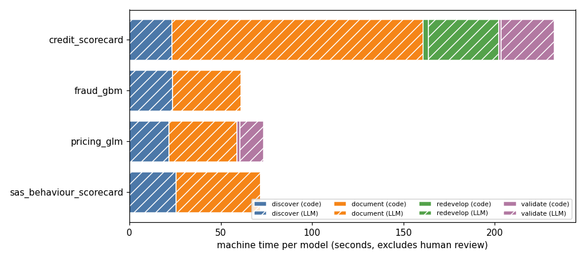

# Benchmark (Stage 7)

Generated 2026-11-08T23:56:06.238913+00:00 by `make benchmark`. Machine time = deterministic work re-executed and timed in this run + live LLM latency recorded in the ledger (all live calls for that model and stage, including failed attempts and reruns triggered by gate rejections). Human review time is not measured.

## Machine time per model (seconds)

| Model | discover | document | redevelop | validate | Total | LLM calls | LLM cost |
|---|---|---|---|---|---|---|---|
| credit_scorecard | 23.1 (0.0 code + 23.1 LLM) | 137.7 (0.0 code + 137.7 LLM) | 41.5 (2.9 code + 38.6 LLM) | 30.2 (1.2 code + 29.0 LLM) | 232.5 | 10 | $0.714 |
| fraud_gbm | 23.5 (0.0 code + 23.5 LLM) | 37.5 (0.0 code + 37.5 LLM) | - | - | 61.0 | 5 | $0.143 |
| pricing_glm | 21.6 (0.0 code + 21.6 LLM) | 37.4 (0.0 code + 37.4 LLM) | - | 14.4 (1.6 code + 12.8 LLM) | 73.3 | 5 | $0.191 |
| sas_behaviour_scorecard | 25.4 (0.0 code + 25.4 LLM) | 46.5 (0.0 code + 46.5 LLM) | - | - | 71.9 | 5 | $0.173 |

## Manual comparison

**Manual baseline not supplied.** Fill in `config/manual_baseline.yaml` (hours per activity, the source of the figures and review minutes per gate) and re-run `make benchmark`. No speed-up is reported until then.

## Consistency across models

Every model goes through the same schema, scanner, agents, evidence check and thresholds. The table shows what each produced.

| Model | Lang | Inventory fields found | Quotes | Gaps | Doc sections (high conf.) | Claims dropped | Unknowns | Variable coverage | Validation checks | Overall | Gate decisions (rejections) |
|---|---|---|---|---|---|---|---|---|---|---|---|
| credit_scorecard | R | 6/6 | 8 | 5 | 6 (4) | 0 | 10 | 14/14 | 12 | RED | 6 (1) |
| fraud_gbm | Python | 3/6 | 4 | 4 | 6 (4) | 0 | 9 | 30/30 | - | - | 2 (1) |
| pricing_glm | Python | 6/6 | 8 | 4 | 6 (4) | 0 | 8 | 8/9 | 6 | AMBER | 3 (0) |
| sas_behaviour_scorecard | SAS | 5/6 | 6 | 3 | 6 (5) | 0 | 12 | n/a (not executed) | - | - | 2 (1) |

## Reproducibility

- credit_scorecard parity re-check: 38/38 parity checks and 18 unit cases, passed = True.
- credit_scorecard validation evidence rebuilt twice: identical = True; equal to the stored Stage 5 evidence = True (26 metrics, digest f262ab01b797).
- pricing_glm validation evidence rebuilt twice: identical = True; equal to the stored Stage 5 evidence = True (14 metrics, digest c155e99249d9).

LLM outputs are not re-generated here: they are cached by prompt hash, so a rerun replays the approved text for free. Without the cache the documentation agent can phrase things differently; the evidence check and the gates are the consistency control for that part.
