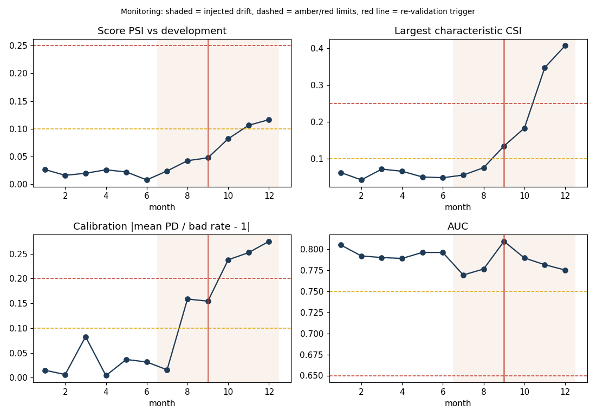

# Monitoring report: Retail Application Scorecard (RCS-APP-02)

Generated 2026-11-08T23:54:29.411452+00:00. Baseline: development (train) scores of the Gate 3/4-approved rebuild redeveloped/credit_scorecard/scorecard.py, 700 rows

Simulation: 12 monthly batches of 1000 rows resampled from the test set (seed 42 + month). SYNTHETIC drift from month 7: credit_amount x(1 + 0.04k), a share 0.08k of loans 12 months longer, riskier intake (weight exp(0.15k*bad)). Outcomes are assumed observed at batch time (no maturity lag).

Thresholds (green/amber limits, from `validate.thresholds`): psi_max [0.1, 0.25], calib_ratio_dev_max [0.1, 0.2], auc_min [0.75, 0.65]

| month | drift_k | n | bad_rate | mean_pd | score_psi | max_csi | max_csi_var | calib_dev | auc | rag |
|---|---|---|---|---|---|---|---|---|---|---|
| 1 | 0 | 1,000 | 0.308 | 0.303 | 0.026 | 0.062 | savings | 0.015 | 0.805 | green |
| 2 | 0 | 1,000 | 0.284 | 0.282 | 0.016 | 0.042 | age | 0.006 | 0.792 | green |
| 3 | 0 | 1,000 | 0.318 | 0.292 | 0.020 | 0.071 | age | 0.083 | 0.790 | green |
| 4 | 0 | 1,000 | 0.294 | 0.295 | 0.026 | 0.065 | age | 0.004 | 0.789 | green |
| 5 | 0 | 1,000 | 0.304 | 0.293 | 0.022 | 0.050 | age | 0.037 | 0.796 | green |
| 6 | 0 | 1,000 | 0.307 | 0.297 | 0.008 | 0.048 | purpose | 0.031 | 0.796 | green |
| 7 | 1 | 1,000 | 0.309 | 0.304 | 0.024 | 0.055 | age | 0.016 | 0.770 | green |
| 8 | 2 | 1,000 | 0.383 | 0.322 | 0.042 | 0.075 | savings | 0.159 | 0.777 | amber |
| 9 | 3 | 1,000 | 0.391 | 0.331 | 0.047 | 0.134 | duration | 0.154 | 0.810 | amber |
| 10 | 4 | 1,000 | 0.459 | 0.350 | 0.082 | 0.183 | duration | 0.238 | 0.790 | red |
| 11 | 5 | 1,000 | 0.493 | 0.368 | 0.106 | 0.347 | duration | 0.253 | 0.782 | red |
| 12 | 6 | 1,000 | 0.514 | 0.372 | 0.116 | 0.407 | duration | 0.275 | 0.775 | red |

## Trigger: month 9 (AMBER)

month 9 rated AMBER (2 consecutive amber months): Largest characteristic CSI 0.134 (AMBER, limits [0.1, 0.25]); Calibration |mean PD / bad rate - 1| 0.154 (AMBER, limits [0.1, 0.2])

### Alert (monitor agent, numbers filled in from evidence)

The Retail Application Scorecard (RCS-APP-02) triggered re-validation in month 9 under the two-consecutive-amber rule, following amber ratings in months 8 and 9. The month 9 breach was driven by the largest characteristic CSI of 0.134 (duration, amber band 0.1 to 0.25 range) and calibration deviation of 0.154 against the amber limit of 0.2. Calibration deviation first rose to amber in month 8 and worsened to red by months 10 to 12, while max CSI moved to red from month 11, and score PSI reached amber in months 11 and 12. Discrimination remained within green limits throughout, with AUC at 0.810 in month 9, so the deterioration is in population stability and calibration rather than ranking power. The simulated drift began in month 7, and the model should be treated as no longer reliably calibrated to the current application population.

Likely drivers:
- Duration CSI of 0.134 is the largest contributor in month 9, consistent with a shift in the mix of loan term requested, which is the characteristic that drives the CSI breach.
- Credit amount CSI of 0.092 and age CSI of 0.081 are also elevated relative to the other characteristics, suggesting a broader intake shift toward larger, longer loans and a different age profile.
- Calibration deviation rising while AUC stayed green is consistent with a change in the bad-rate level of the population rather than a loss of rank ordering; mean PD of 0.331 against an observed bad rate of 0.391 indicates under-prediction of risk. This is suggestive only, as the input does not establish the root cause of the intake change.
- The input describes the drift as synthetic from month 7 with riskier intake and longer durations, so the driver attribution reflects the simulation design and should not be presented as an observed business event.

Recommended actions:
- Commission full re-validation of RCS-APP-02 focused on the duration, credit amount and age characteristics and on calibration to the current population.
- Investigate the root cause of the duration and credit amount shift in application data, including whether a product, channel or pricing change is responsible, and document the finding.
- Assess the impact of the calibration deviation on expected loss and capital and determine whether interim recalibration or an overlay is needed while re-validation is in progress.
- Confirm that outcome data is observed at batch time as the simulation assumes; if real loans mature with a lag, the performance monitoring basis must be reviewed before drawing final conclusions.
- Escalate to the model owner and model risk committee given red ratings on CSI and calibration in months 10 to 12, and track the monthly monitoring results until the model is re-validated or remediated.

## Re-validation: approved

Report: `docs/validation/credit_scorecard_revalidation_m09.html`. Previous validation: {'generated_at': '2026-11-08T21:43:36.727305+00:00', 'overall_rag': 'amber', 'report_html': 'docs/validation/credit_scorecard.html'}
